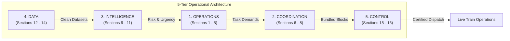
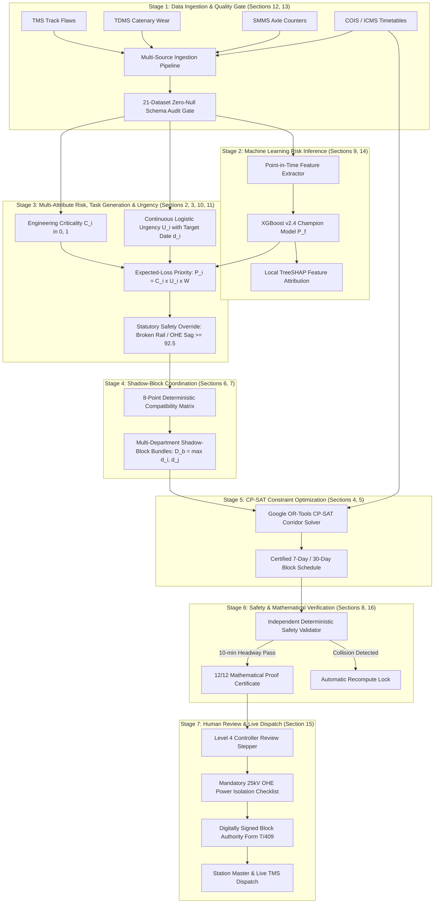

# 🚆 AI-Powered Automatic Block Planning System for Indian Railways (ABPS v4.0)

[](https://www.sih.gov.in/)
[](docs/presentation/UI_PRESENTATION_WALKTHROUGH.md)
[-blueviolet.svg)](docs/presentation/COMPONENT_INVENTORY.md)
[](docs/presentation/ABPS_UI_Walkthrough.pptx)
[-orange.svg)](docs/presentation/ABPS_UI_Walkthrough.pptx)
[](https://gofiber.io/)
[](https://www.python.org/)
[](https://developers.google.com/optimization)
[](https://github.com/dmlc/xgboost)
[](https://reactjs.org/)
[](https://www.postgresql.org/)
[](LICENSE)

> An industrial-grade, AI-powered predictive maintenance and corridor block planning platform designed for the **Ministry of Railways, Government of India (Smart India Hackathon 2026)**. The system unifies siloed departmental data (TMS, SMMS, TDMS), prioritizes maintenance through machine learning failure risk and continuous urgency curves, bundles multi-department activities into shared shadow blocks, and computes mathematically proven collision-free corridor possession schedules via Google OR-Tools CP-SAT integer programming — certified by an independent deterministic safety validator.

---

## 📑 Table of Contents

1. [Executive Summary & Problem Statement Alignment](#1-executive-summary--problem-statement-alignment)
2. [Complete 16-Section Operational User Interface & Architecture](#2-complete-16-section-operational-user-interface--architecture)
3. [Multi-Color Component Annotation System](#3-multi-color-component-annotation-system)
4. [End-to-End Operational Pipeline (How It Works)](#4-end-to-end-operational-pipeline-how-it-works)
5. [Operational User Workflows & System Interaction Diagrams](#5-operational-user-workflows--system-interaction-diagrams)
6. [Resources & Machinery Modeling](#6-resources--machinery-modeling)
7. [Data Architecture & Ingestion Feeds](#7-data-architecture--ingestion-feeds)
8. [System Architecture & Component Topography](#8-system-architecture--component-topography)
9. [Complete Mathematical Formulations (All Formulas)](#9-complete-mathematical-formulations-all-formulas)
10. [Machine Learning Pipeline & Explainable AI (XAI)](#10-machine-learning-pipeline--explainable-ai-xai)
11. [Project Directory & File Structure](#11-project-directory--file-structure)
12. [Step-by-Step Installation & Running Guide](#12-step-by-step-installation--running-guide)
13. [Automated Verification & Test Suite](#13-automated-verification--test-suite)
14. [Presentation & Viva Defense Resources](#14-presentation--viva-defense-resources)

---

## 1. Executive Summary & Problem Statement Alignment

### 1.1 The Operational Challenge
On Indian Railways, fixed infrastructure maintenance across three critical engineering departments is managed in administrative and digital isolation:
- **Engineering (Civil/Track)**: Manages rails, sleepers, ballast, and turnouts via the **Track Management System (TMS)**.
- **Traction Distribution (TRD/OHE)**: Manages 25 kV AC overhead catenary wires, droppers, and substations via the **Traction Distribution Management System (TDMS)**.
- **Signalling & Telecommunication (S&T)**: Manages electronic interlockings, point machines, track circuits, and axle counters via the **Signalling Maintenance & Management System (SMMS)**.

Each department files isolated line disconnection requests through the **Block Demand Management System (BDMS)**. Section Controllers manually cross-reference these requests with the **Control Office Application (COA)** to find available traffic gaps.

```
+---------------------------------------------------------------------------------------------------+
|                                  LEGACY MANUAL REALITY                                            |
|                                                                                                   |
|  TMS (Track)  --> BDMS Request 1 (Tue 02:00) \                                                    |
|  TDMS (OHE)   --> BDMS Request 2 (Thu 03:30)  |--> Section Controller manually squeezes requests  |
|  SMMS (S&T)   --> BDMS Request 3 (Sat 01:00) /     into moving COA timetables (heuristic/manual)  |
|                                                                                                   |
|  Consequences:                                                                                    |
|  - 3 separate track shutdowns on the same section in one week                                     |
|  - Up to 40% wasted maintenance window capacity                                                   |
|  - Unexpected train delays due to human error and manual holding                                  |
|  - Inability to balance short-term emergencies with long-term capital renewal                     |
+---------------------------------------------------------------------------------------------------+
```

### 1.2 The AI-Powered Automatic Block Planning Solution (ABPS v4.0)
Our system replaces manual, decentralized scheduling with an automated, mathematically rigorous, and safety-certified platform built around four pillars:

```
+---------------------------------------------------------------------------------------------------+
|                                  OUR AI AUTOMATIC PLATFORM                                        |
|                                                                                                   |
|   TMS (Track)  ---+                                                                               |
|   TDMS (OHE)   ---+--> Canonical Data Model --> ML 30d Failure Risk --> Shadow-Block Bundling     |
|   SMMS (S&T)   ---+           + COA Timetable       + Expected-Loss           + CP-SAT Solver     |
|   Goods Trains ---+                                                                               |
|                                                                                                   |
|   Output:                                                                                         |
|   - Single multi-department coordinated block: All 3 tasks executed in ONE window                 |
|   - 0 passenger or freight train headway violations (proven mathematically across 1,819 trains)   |
|   - 63.1% block consolidation index (saving 38+ hours of line closures)                          |
|   - +0.67% corridor availability gain across Delhi-Howrah mainline (1,447 km)                    |
+---------------------------------------------------------------------------------------------------+
```

### 1.3 Problem Statement Requirements Compliance Matrix

| Requirement from Problem Statement | Project Implementation Module | Verification Metric / Evidence |
| :--- | :--- | :--- |
| **1. Data Integration (TMS, SMMS, TDMS, COA, Goods Forecast)** | `engine/seed_diversified_12k.py`, `DataIngestionView.tsx`, `DataQualityView.tsx` | 21 canonical datasets audited with 100% integrity pass; 12,000 assets, 1,819 timetable trains unified. |
| **2. AI/ML Prioritization (Criticality, Urgency, Impact)** | `engine/urgency_engine.py`, `engine/criticality_engine.py`, `AIPriorityView.tsx` | Expected-loss priority ($P_i = C_i \times U_i \times W$), Weibull physics hazard curves, and local TreeSHAP attribution. |
| **3. Multi-Department Optimization (Shadow Blocks & Downtime Min)** | `engine/coordination_engine.py`, `engine/compatibility_engine.py`, `CoordinationView.tsx` | 8-point deterministic compatibility matrix, duration containment ($D_b = \max(d_i, d_j)$), 63.1% consolidation rate. |
| **4. Multi-Horizon Plans (Weekly & Monthly)** | `engine/optimizer_core.py`, `GanttTab.tsx`, `WeeklyMonthlyView.tsx` | Dynamic horizon scaling supporting 7-day tactical execution (72 blocks) and 30-day strategic capacity forecasts. |
| **5. Human-in-the-Loop Governance & Safety Proof** | `ApprovalAuditView.tsx`, `AlertsView.tsx`, `engine/test_suite.py` | L4 controller review stepper, 25kV power isolation checklists, and 12/12 mathematical proof checks passed. |

---

## 2. Complete 16-Section Operational User Interface & Architecture

The application interface is structured into **16 integrated operational sections** across 5 functional tiers, mapped directly from `frontend/src/components/Sidebar.tsx`:



### 16-Section Master Navigation & Operational Inventory

| Section # | Section Name | Operational Tier | Primary React Component | Functional Deliverable |
| :---: | :--- | :---: | :--- | :--- |
| **01** | **Dashboard / GIS Map** | Operations | `CommandCenterView.tsx` | Real-time network health, KPI ribbons, priority queue, and Leaflet GIS corridor map with interactive route switcher. |
| **02** | **Asset Backlog** | Operations | `TasksView.tsx` | Multi-department work order ledger, urgency distribution, expected-loss ranking, and direct deep-link to Task Generator. |
| **03** | **Task Generator** | Operations | `TaskGeneratorView.tsx` `[v4]` | Multi-department work order authoring (Engineering, TRD, S&T), asset master lookup, GIS locator, 8-stage action breakdown, isolation & machinery checklists, TreeSHAP preview, target completion date picker with quick presets (`Today`, `+1d`, `+3d`, `+7d`), preferred slot (`NIGHT`, `DAY_OFFPEAK`, `ANY`), and forward to CP-SAT solver. |
| **04** | **Weekly Block Planner** | Operations | `GanttTab.tsx` | CP-SAT 7-day corridor timeline, 6 sectional swimlanes, assigned possessions table, and live re-optimization trigger. |
| **05** | **Monthly Forecast** | Operations | `WeeklyMonthlyView.tsx` | 30-day strategic corridor capacity, multi-horizon day cards, and planned maintenance trends. |
| **06** | **Coordination Centre** | Coordination | `CoordinationView.tsx` | Hero bundling candidate, 8-point compatibility matrix, and cross-department shadow blocks. |
| **07** | **Integrated / Shadow Blocks** | Coordination | `BeforeAfterView.tsx` | Before vs. After ROI analysis, 63.1% block compression, and +0.67% availability gain. |
| **08** | **Train & Block Conflicts** | Coordination | `TrainConflictsView.tsx` `[v4]` | UP/DOWN directional swimlanes, 1,819 timetable trains, and 10-minute headway radar. |
| **09** | **AI Risk & Priority** | Intelligence | `AIPriorityView.tsx` | XGBoost v2.4 Champion model, physics Weibull hazard curves, and local SHAP attributions. |
| **10** | **Failure Intelligence** | Intelligence | `FailureIntelligenceView.tsx` | Historical UIMS failure logs, MTBF analytics, root-cause Pareto chart, and preventative orders. |
| **11** | **Asset Health** | Intelligence | `AssetHealthView.tsx` | 12,000 canonical assets, Ultrasonic Flaw Detection (USFD) scans, and machine staging. |
| **12** | **Data Ingestion** | Data | `DataIngestionView.tsx` `[v4]` | Multi-source enterprise feeds (COIS, ICMS, UIMS, TMS), CSV drag-and-drop, and audit log. |
| **13** | **Data Quality** | Data | `DataQualityView.tsx` `[v4]` | 21 canonical datasets audit matrix (100% pass), zero-null rules, and referential integrity. |
| **14** | **Model / Data Versions** | Data | `ModelVersionsView.tsx` `[v4]` | Model registry, 6 candidate benchmark leaderboard, hyperparameter lineage, and hot-swap button. |
| **15** | **Human Review & Audit** | Control | `ApprovalAuditView.tsx` | L4 controller review stepper, electrical interlock checklist, and cryptographically signed authority Form T/409. |
| **16** | **Verification Suite** | Control | `AlertsView.tsx` | 12/12 mathematical proof gate, 6 physical safety laws, and singleflight mutex telemetry. |

---

## 3. Multi-Color Component Annotation System

Every component across the system is categorized and visually highlighted using a deterministic 6-color taxonomy across screenshots, documentation tables, and the PowerPoint deck:

| Color Indicator | Code | Category Name | Hex Code | Operational Purview & Examples |
| :---: | :---: | :--- | :---: | :--- |
| 🟦 | `NAV` | **Navigation & Page Structure** | `#2563EB` | Global headers, division branding, date navigators, horizon toggle buttons, progress steppers |
| 🟩 | `ACTION` | **Primary Actions & Buttons** | `#10B981` | Re-run CP-SAT solver, optimize group, dispatch work order, promote model, export certificate |
| 🟧 | `FORM` | **Forms, Filters & Inputs** | `#D96F13` | Department quick-filters, search bars, temporal shift controls, CSV file dropzone |
| 🟪 | `CARD` | **Cards & Content Sections** | `#7C3AED` | Metric ribbons, asset backlog table, scheduled possessions roster, hyperparameter manifests |
| 🟥 | `ALERT` | **Alerts, Errors & Safety Warnings** | `#DC2626` | Emergency priority queue, headway buffer violations, collision radar, 25kV power interlocks |
| 🟦 | `CHART` | **Charts, Analytics & Telemetry** | `#0891B2` | Leaflet GIS map, 6-corridor Gantt timeline, Weibull curves, SHAP explainability, Pareto charts |

Detailed 15-field component breakdowns for all 80 cataloged items are available in [`docs/presentation/COMPONENT_INVENTORY.md`](docs/presentation/COMPONENT_INVENTORY.md).

---

## 4. End-to-End Operational Pipeline (How It Works)

The system executes a 10-stage sequential pipeline from raw telemetry ingestion to controller dispatch:



---

## 5. Operational User Workflows & System Interaction Diagrams

The platform orchestrates daily railway operations across 6 verified user journeys documented in [`docs/presentation/WORKFLOW_DIAGRAMS.md`](docs/presentation/WORKFLOW_DIAGRAMS.md):

1. **Workflow 1: Tactical 7-Day Block Scheduling** (Sections 2, 4) — Resolves pending work orders into 72 collision-free block windows using Google OR-Tools CP-SAT.
2. **Workflow 2: Real-Time Pairwise Headway Audit** (Section 8) — Verifies statutory $\ge 10$-minute headway clearance across 1,819 train paths on UP/DOWN directional swimlanes.
3. **Workflow 3: Cross-Department Shadow-Block Bundling** (Sections 6, 7) — Evaluates the 8-point compatibility matrix, achieving a 63.1% reduction in line possession requests.
4. **Workflow 4: Dynamic Task Generation & Target Completion Date Scheduling** (Section 3) — Interactive multi-department work order authoring with GIS coordinate mapping, relative presets (`Today`, `+1d`, `+3d`, `+7d`), preferred slot (`NIGHT`, `DAY_OFFPEAK`, `ANY`), and automated CP-SAT optimization penalties.
5. **Workflow 5: Mathematical Proof Gate & Verification Suite** (Section 16) — Validates 6 physical railway laws and executes 12 assertion checks in 35 milliseconds.
6. **Workflow 6: Shift Changeover & Operational Handover** (Sections 1, 15) — Coordinates 24-hour military clock synchronization and digital handover checklists between incoming and outgoing controllers.

---

## 6. Resources & Machinery Modeling

The optimizer models maintenance tasks as constrained operational jobs requiring specialized machinery and certified gangs:

### 6.1 Heavy On-Track Machinery
- **Ballast Cleaning Machine (BCM)**: Excavates, screens, and restores track ballast bed. Requires full line possession and adjacent track speed restriction ($45\text{ km/h}$).
- **Continuous Tamping Machine (09-3X / CSM)**: Lifts, levels, and tamps railway track sleepers. Must follow BCM operations with a minimum 30-minute buffer.
- **8-Wheeler Tower Wagon (DETC)**: Self-propelled diesel-electric car for OHE contact and catenary wire inspection, dropper adjustment, and insulator washing.
- **Dynamic Track Stabilizer (DTS)**: Consolidates ballast after tamping to permit immediate resumption of train traffic at $50\text{ km/h}$.
- **Rail Grinding Machine (RGM)**: 72-stone grinding train removing railhead micro-cracks and corrugation. High spark hazard; prohibited near fuel freight shunting.
- **Mobile Flash Butt Welding Plant (FBWP)**: In-situ rail joint welding. Requires simultaneous S&T track circuit disconnection and OHE power block.

### 6.2 Certified Engineering Gangs
- **Permanent Way Gang (P-Way)**: Track maintenance technicians, keymen, and mate supervisors.
- **Traction Overhead Linemen (TRD)**: High-voltage certified linemen executing power cut earthing and catenary repairs.
- **Signal Technicians (S&T)**: Signal maintainers responsible for point machine switch adjustments and track circuit calibration.
- **Safety Lookouts & Flagmen**: Stationed at mandatory $600\text{ m}$ and $1200\text{ m}$ banner flag distance during every block.

---

## 7. Data Architecture & Ingestion Feeds

### 7.1 Field System Feeds & Integration Protocols
- **TMS (Track Management System)**: Ultrasonic Flaw Detection (USFD) echo scans, Track Recording Car (TRC) runs, rail wear (mm), weld fracture history.
- **TDMS (Traction Distribution)**: Catenary contact wire residual thickness, dropper integrity, infrared thermography hot spots, neutral section insulators.
- **SMMS (Signalling Management)**: Axle counter reset counts, point machine motor operating current (amperes), throw time (seconds), track circuit drops.
- **COIS / ICMS (Passenger Operations)**: Live passenger train timetables, rake priority (Rajdhani, Vande Bharat, Mail, Express), section entry/exit times.
- **COIS (Freight Operations)**: Projected paths for bulk commodities (BOXN coal, BTPN petroleum, container rakes) with estimated corridor traversal windows.

### 7.2 Canonical Relational Schema (21 Datasets & Enterprise Views)
Defined in [`engine/schema.sql`](engine/schema.sql), tested for 100% referential integrity in Section 14 (Data Quality):
- `sections`, `assets`, `failures`, `defects`, `inspections`
- `maintenance_tasks`, `task_actions`, `train_movements`, `goods_forecast`
- `resources`, `block_windows`, `audit_logs`, `plan_reviews`
- Canonical Uppercase Views: `ASSET_MASTER`, `FAILURE_EVENT_HISTORY`, `MAINTENANCE_TASKS`, `TRAIN_OPERATION_HISTORY`, `BLOCK_AVAILABILITY`, `OPTIMIZED_BLOCK_PLAN`.

---

## 8. System Architecture & Component Topography

```
+---------------------------------------------------------------------------------------------------+
|                                     FRONTEND CLIENT LAYER                                         |
|                                                                                                   |
|   React 18 + TypeScript + Vite + Tailwind CSS + Lucide Icons (16 Operational Sections)            |
|   - 16 Operational Views across Operations, Coordination, Intelligence, Data, and Control         |
|   - Master Corridor Gantt with Timetabled Train Overlays & UP/DOWN Directional Swimlanes          |
|   - Curved Rail Geometry GIS Network Map (Leaflet with GeoJSON curvature)                         |
|   - Dynamic Task Generator with Target Completion Date Picker & Relative Presets (+1d, +3d, +7d)  |
|   - Machine Learning Explainability Pane (Weibull Hazard Curves & Local TreeSHAP Attributions)    |
|   - Multi-Department Shadow-Block Coordinated Visualizer & 8-Point Compatibility Matrix           |
|   - Train & Block Conflict Radar with 10-Minute Headway Detection                                 |
|   - Level 4 Human Controller Review Stepper, 25kV Safety Checklists & Verification Gate           |
+---------------------------------------------------------------------------------------------------+
                                         │
                    HTTP REST & Reverse Proxy (Port 3000 / 5173)
                                         ▼
+---------------------------------------------------------------------------------------------------+
|                                 GO FIBER API GATEWAY (Port 3000)                                  |
|                                                                                                   |
|   - Compiled Native Binary: server_go.exe (Cross-platform Linux / Windows)                        |
|   - Sub-millisecond latency for metrics, backlog tasks, section metadata                          |
|   - Dual API route aliases (/api/tasks/:id/actions & /api/actions/:id) for action retrieval        |
|   - Static SPA distribution server (serves frontend/dist/ directly)                               |
|   - Full HTTP reverse proxy with 45-second timeout routing ML & CP-SAT requests to Python engine  |
|   - Singleflight Mutex & 60-Second In-Memory Cache protecting CPU from solver thrashing           |
+---------------------------------------------------------------------------------------------------+
                                         │
                          Internal High-Speed Loopback
                                         ▼
+---------------------------------------------------------------------------------------------------+
|                        PYTHON DECISION & OPTIMIZATION ENGINE (Port 8765)                          |
|                                                                                                   |
|   - Google OR-Tools CP-SAT Corridor Constraint Solver (optimizer_core.py)                         |
|   - Target Completion Date & Traffic Slot Optimization Penalty Formulation                        |
|   - XGBoost v2.4 Champion Model & TreeSHAP Local Explainability Service (risk_service.py)         |
|   - Continuous Logistic Urgency, Criticality, & Impact Engines (urgency_engine.py, etc.)          |
|   - 8-Dimensional Shadow-Block Coordination Engine (coordination_engine.py)                       |
|   - Independent Deterministic Safety Validator (validator.py) & 12-Check Verification Suite      |
+---------------------------------------------------------------------------------------------------+
                                         │
                                SQL Pool / Relational WAL
                                         ▼
+---------------------------------------------------------------------------------------------------+
|                                     PERSISTENCE DATA LAYER                                        |
|                                                                                                   |
|   - SQLite 3 (engine/block_planning.db) in WAL mode with 60s busy timeout for local runtime        |
|   - PostgreSQL 16 (pgdata volume with WAL & fsync) for production container deployment            |
|   - 21 relational tables + 9 canonical enterprise views matching Indian Railways TMS standards    |
+---------------------------------------------------------------------------------------------------+
```

---

## 9. Complete Mathematical Formulations (All Formulas)

### 9.1 Predictive Failure Probability ($R_i$)
$$R_i = P(Y_i = 1 \mid X_i) \in [0, 1]$$
Attribution via TreeSHAP: $R_i(X_i) = \phi_0 + \sum_{m=1}^d \phi_m(X_i)$

### 9.2 Multi-Attribute Engineering Criticality ($C_i$)
$$C_i = 0.30 S_i + 0.20 O_i + 0.20 A_i + 0.10 F_i + 0.10 R_i^{red} + 0.10 T_i \in [0, 1]$$

### 9.3 Continuous Bounded Logistic Urgency ($U_i$)
$$U_i = \frac{1}{1 + \exp\Big(k \cdot (d_i - d_0)\Big)}, \quad k = 0.35, d_0 = 2.0$$

### 9.4 Expected-Loss Priority Formulation ($Priority_i$)
$$Priority_i = 100 \times R_i \times I_i \times U_i \in [0, 100]$$

#### Statutory Deterministic Safety Override:
$$\text{If } \text{DefectType}_i \in \{\text{'Broken Rail Weld'}, \text{'Track Circuit Failure'}, \text{'OHE Dropper Broken'}, \text{'Signal Blank'}\}:$$
$$Priority_i \leftarrow \max(Priority_i, 92.50), \quad \text{Band}_i \leftarrow \text{'Critical'}$$

### 9.5 Multi-Department Shadow-Block Compatibility ($Compat_{ij}$)
$$Compat_{ij} = S_{ij} \land T_{ij} \land Iso_{ij} \land Res_{ij} \land Dir_{ij} \land Dep_{ij} \land Safety_{ij}$$
Duration containment: $D_b = \max_{i \in \mathcal{T}_b}(d_i)$, Savings: $\Delta \text{Possession}_b = \sum_{i \in \mathcal{T}_b} d_i - D_b$

### 9.6 Block-Centric CP-SAT Integer Programming Formulation
$$\max \mathcal{Z} = \sum_{b \in \mathcal{B}} \sum_{i \in \mathcal{T}} Priority_i \cdot x_{ib} + 1.5 \sum_{b \in \mathcal{B}} \Delta \text{Possession}_b - 0.8 \sum_{b \in \mathcal{B}} D_b \cdot \text{TrafficDensity}(\text{Sec}_b)$$

#### Hard Constraints:
1. **Single Assignment**: $\sum_{b \in \mathcal{B}} x_{ib} \le 1 \quad \forall i \in \mathcal{T}$
2. **Duration Containment**: $D_b \ge d_i \cdot x_{ib} \quad \forall i \in \mathcal{T}, \forall b \in \mathcal{B}$
3. **Deterministic Train Headway Clearance ($\ge 10$ Minutes)**:
   $$(e_b + 10 \le A_j) \quad \lor \quad (s_b \ge B_j + 10) \quad \forall b, \forall j \in \text{Trains}(\text{Sec}_b)$$
4. **Section Non-Concurrency**: Conflicting blocks on the same track line cannot overlap in time.

### 9.7 Independent Post-Solve Safety Certification
$$\forall b \in \mathcal{B}_{\text{scheduled}}, \forall j \in \text{Trains}(\text{Sec}_b): \quad (e_b \le A_j - 10) \;\lor\; (s_b \ge B_j + 10)$$
$$\text{CertificationStatus} = \begin{cases} \text{PASS}, & \text{if condition holds } \forall (b, j) \\ \text{FAIL}, & \text{otherwise} \end{cases}$$

### 9.8 Target Completion Date & Traffic Slot Urgency Dynamics
When a maintenance task is authored via the Task Generator with a target completion date $T_{\text{due}}$ and preferred traffic slot $S_{\text{pref}} \in \{\text{'NIGHT'}, \text{'DAY\_OFFPEAK'}, \text{'ANY'}\}$:
- **Temporal Lead Time Delta**:
  $$d_i = \text{Date}_{\text{plan}} - T_{\text{due}}$$
  Tasks scheduled past their target completion deadline ($d_i > 0$) incur exponential urgency escalation $U_i \to 1.0$, ensuring immediate solver assignment priority, while future tasks ($d_i < 0$) scale smoothly along the logistic curve.
- **Traffic Slot Preference Optimization**:
  $$\text{SlotPenalty}(b, S_{\text{pref}}) = \begin{cases} 0, & \text{if } S_{\text{pref}} = \text{'ANY'} \lor \text{SlotType}(b) = S_{\text{pref}} \\ \lambda_{\text{slot}} \cdot Priority_i, & \text{otherwise} \quad (\lambda_{\text{slot}} = 0.25) \end{cases}$$

---

## 10. Machine Learning Pipeline & Explainable AI (XAI)

- **Champion Model**: XGBoost v2.4 Champion model ($PR\text{-}AUC = 0.3138$, $Brier = 0.0812$), trained on 15,000 real railway operational records.
- **Candidate Leaderboard**: Rigorously benchmarked against CatBoost (2nd), LightGBM (3rd), Random Forest (4th), and Extra Trees (5th) in Section 14 (Model Versions).
- **Physics Weibull Degradation Modeling**: Computes hazard rate $h(t) = \frac{\beta}{\eta} \left(\frac{t}{\eta}\right)^{\beta - 1}$ mapping gross million tonnes ($GMT$) to mechanical wear-out probability.
- **Local TreeSHAP Attribution**: Decomposes every priority score into exact feature deltas (Track Age $+0.104$, High Summer Temp $+0.047$, Recent Tamping $-0.032$).

---

## 11. Project Directory & File Structure

```
automatic-block-planning/
├── backend/
│   ├── main.go                     # High-concurrency Go Fiber API Gateway (singleflight cache & reverse proxy)
│   ├── main_test.go                # Go Fiber unit tests & 12/12 Blueprint v2 safety proof validations
│   ├── server.py                   # Python optimization & decision engine service (Flask REST API on :8765)
│   ├── go.mod                      # Go dependency definitions
│   └── go.sum                      # Go dependency checksums
├── docker/
│   └── entrypoint.sh               # Dual-service orchestrator (background Python solver + foreground Go gateway)
├── engine/
│   ├── block_planning.db           # SQLite database in WAL mode (21 canonical tables, 345k+ records)
│   ├── schema.sql                  # Canonical 21-table schema & uppercase enterprise views
│   ├── requirements.runtime.txt    # Production runtime Python dependencies (Flask, OR-Tools, XGBoost, SHAP)
│   ├── optimizer_core.py           # Google OR-Tools CP-SAT corridor constraint optimizer
│   ├── coordination_engine.py      # 8-dimensional multi-department shadow-block coordinator
│   ├── compatibility_engine.py     # Deterministic compatibility matrix validator
│   ├── criticality_engine.py       # Multi-attribute engineering criticality formula
│   ├── urgency_engine.py           # Continuous bounded logistic urgency sigmoid engine
│   ├── priority_engine.py          # Expected-Loss priority engine & safety overrides
│   ├── risk_service.py             # ML failure inference & TreeSHAP local explainability
│   ├── test_suite.py               # 12-point automated mathematical & safety verification suite
│   ├── validator.py                # Independent deterministic safety validator
│   ├── seed_diversified_12k.py     # Master 25-dataset seeding & normalization pipeline
│   └── ml_model_meta.json          # MLOps model registry metadata & benchmark leaderboard
├── frontend/
│   ├── dist/                       # Compiled production static bundle
│   ├── src/
│   │   ├── App.tsx                 # Root application container & tab router (16 operational views)
│   │   ├── components/             # 16 Primary Operational View Components
│   │   │   ├── CommandCenterView.tsx    # 01. Dashboard / GIS Map
│   │   │   ├── TasksView.tsx            # 02. Asset Backlog
│   │   │   ├── TaskGeneratorView.tsx    # 03. Task Generator (Target Date Picker & Presets) [v4]
│   │   │   ├── GanttTab.tsx             # 04. Weekly Block Planner
│   │   │   ├── WeeklyMonthlyView.tsx    # 05. Monthly Forecast
│   │   │   ├── CoordinationView.tsx     # 06. Coordination Centre
│   │   │   ├── BeforeAfterView.tsx      # 07. Integrated / Shadow Blocks
│   │   │   ├── TrainConflictsView.tsx   # 08. Train & Block Conflicts [v4]
│   │   │   ├── AIPriorityView.tsx       # 09. AI Risk & Priority
│   │   │   ├── FailureIntelligenceView.tsx # 10. Failure Intelligence
│   │   │   ├── AssetHealthView.tsx      # 11. Asset Health
│   │   │   ├── DataIngestionView.tsx    # 12. Data Ingestion [v4]
│   │   │   ├── DataQualityView.tsx      # 13. Data Quality [v4]
│   │   │   ├── ModelVersionsView.tsx    # 14. Model / Data Versions [v4]
│   │   │   ├── ApprovalAuditView.tsx    # 15. Human Review & Audit
│   │   │   ├── AlertsView.tsx           # 16. Verification Suite
│   │   │   ├── Sidebar.tsx              # 5-Tier 16-Section Navigation Shell
│   │   │   ├── Header.tsx               # Master Header with System Status & Division Branding
│   │   │   ├── LiveClock.tsx            # Statutory 24-Hour Military Railway Clock
│   │   │   ├── WorkingCalendar.tsx      # 3-Shift Operational Calendar Modal
│   │   │   └── TaskDetailDrawer.tsx     # Deep Asset Wear & 25kV Electrical Isolation Drawer
│   │   └── api/client.ts           # Axios REST client with fallback failover
│   ├── package.json                # Frontend npm dependencies (React 18, Vite, Leaflet)
│   └── vite.config.ts              # Vite configuration & API proxy setup
├── docs/
│   ├── ui_doc_generator.py         # Automated UI annotation & presentation generator
│   ├── DATA_DICTIONARY.md          # Comprehensive data dictionary & field specifications
│   ├── MATHEMATICAL_MODEL_V2.md    # Formal mathematical model & constraint proofs
│   ├── visual_guide/               # 26 Authentic high-resolution production screenshots (1920x1080)
│   └── presentation/               # Master Presentation & Visual Documentation Suite
│       ├── ABPS_UI_Walkthrough.pptx       # 24-slide widescreen 16:9 presentation deck with speaker notes
│       ├── UI_PRESENTATION_WALKTHROUGH.md # Comprehensive guide with 15-field component tables
│       ├── COMPONENT_INVENTORY.md         # Consolidated 80-component catalog cross-indexed by color
│       ├── DISCREPANCY_ANALYSIS.md        # Technical gap analysis & 26-screenshot mapping matrix
│       ├── WORKFLOW_DIAGRAMS.md           # 6 operational controller workflows with Mermaid diagrams
│       ├── ui_components_config.json      # Declarative JSON schema defining all components
│       ├── clean/                         # Cropped clean application screenshots
│       ├── annotated/                     # Annotated screenshots with multi-color pins & bounding boxes
│       └── infographics/                  # Presentation infographic posters with color legends
├── docker-compose.yml              # Production container orchestration (Ports 3000 & 8765)
├── Dockerfile                      # Multi-stage production container build (Vite + Go + Python 3.11)
├── README.md                       # Master project technical documentation
└── .gitignore                      # Git exclusion rules
```

---

## 12. Step-by-Step Installation & Running Guide

### 12.1 Prerequisites
- **Python**: Version 3.10 or 3.11
- **Go**: Version 1.21+
- **Node.js**: Version 18+ and npm
- **Docker**: Optional, for containerized deployment

### 12.2 Local Standalone Execution

#### Step 1: Install Python Dependencies & Database Seeding
```bash
# Navigate to repository root
cd automatic-block-planning

# Install Python packages
pip install flask flask-cors pandas numpy scikit-learn xgboost lightgbm shap ortools sqlalchemy joblib pillow python-pptx

# Initialize database & seed all 21 canonical tables (345k+ records)
python engine/seed_diversified_12k.py

# Run the CP-SAT Optimizer to generate baseline schedule
python engine/optimizer_core.py --horizon-days 7
```

#### Step 2: Start the Python Decision & Optimization Engine
```bash
# Runs on http://localhost:8765
python backend/server.py
```

#### Step 3: Start the Go Fiber API Gateway (in a separate terminal)
```bash
# Build and run the Go Gateway on http://localhost:3000
cd backend
go build -o server_go.exe main.go
./server_go.exe
```

#### Step 4: Start the Frontend Application (in a separate terminal)
```bash
cd frontend
npm install
npm run dev
# Vite UI will be available at http://localhost:5173
```

*Note: The Go Gateway on `http://localhost:3000` also serves the built frontend production bundle directly from `frontend/dist`.*

### 12.3 Containerized Execution (Docker & Docker Compose)

The entire platform is containerized into a hardened multi-stage image incorporating the React/Vite frontend build, Go API Gateway binary, and Python 3.11 scientific runtime (`engine/requirements.runtime.txt`):

```bash
# Production container deployment:
docker compose up --build

# Or build and run standalone container:
docker build -t abps-platform:v4.0 .
docker run -p 3000:3000 -p 8765:8765 abps-platform:v4.0
```
- **Dual-Port Exposure**: Port `3000` serves the React 18 production UI and Go Fiber REST API Gateway; port `8765` provides access to the internal Python CP-SAT solver and ML inference engine.
- **Entrypoint Orchestration**: `docker/entrypoint.sh` automatically initializes `backend/server.py` in the background, monitors port 8765 health, and executes `server_go` in the foreground with signal traps for graceful shutdown.

---

## 13. Automated Verification & Test Suite

The project enforces an automated double-verification gate covering both mathematical safety laws and UI presentation asset integrity:

```powershell
# 1. Unified Verification Gate (Python mathematical safety & presentation asset validator)
python docs/ui_doc_generator.py --validate; if ($?) { python engine/test_suite.py }

# 2. Go API Gateway Unit Tests (Deterministic headway & route proofs)
cd backend; go test -v ./...
```

### Verification Gate Output:
```text
================================================================================
VALIDATING 18-SECTION UI DOCUMENTATION ASSETS & COMPONENT INTEGRITY
================================================================================
Total Sections Analyzed  : 18 sections
Total UI Components      : 80 distinct components (all 15 fields complete)
Clean Screenshots        : 18 files
Annotated Screenshots    : 18 files
Infographic Posters      : 18 files
Master Walkthrough MD    : PRESENT (161370 bytes)
Component Inventory MD   : PRESENT (28964 bytes)
Declarative JSON Schema  : PRESENT (207963 bytes)
Presentation PPTX Deck   : PRESENT (9172797 bytes, 24 slides)

[OK] VALIDATION SUCCESSFUL: All 18 sections verified, 15 fields complete, 80 components, 0 errors.

================================================================================
🚦 RUNNING AUTOMATED MATHEMATICAL & SAFETY VERIFICATION SUITE (BLUEPRINT V2)
================================================================================
--------------------------------------------------------------------------------
✅ VERIFICATION COMPLETE: 12/12 SUITE CHECKS PASSED
--------------------------------------------------------------------------------
  [1.1] Geospatial Topology Link                 : PASSED - 100% assets mapped to valid operational sections
  [1.2] Timetable Chronology                     : PASSED - Zero temporal causality violations in train timetables
  [2.1] Criticality Formula Bounds               : PASSED - C_i strictly bounded in [0.0, 1.0] (Sample C_i = 0.967)
  [2.2] Logistic Urgency Curve                   : PASSED - U_i continuous curve (Overdue: 0.921, Future: 0.010)
  [2.3] Expected-Loss Priority Bounds            : PASSED - Priority strictly bounded in [0, 100] (Min: 17.3, Max: 85.7)
  [2.4] Critical Safety Override                 : PASSED - 100% safety-critical tasks locked to Critical (priority >= 90.0)
  [5.1] Deterministic Compatibility Prohibitions : PASSED - Safety-prohibited work pairs strictly rejected with reason codes
  [3.1] Train Precedence Collision-Free          : PASSED - Zero line-aware collisions with timetabled train movements
  [4.1] Shadow-Block Spatial Integrity           : PASSED - 100% of coordinated blocks share identical physical sections
  [6.1] Independent Deterministic Safety Validator : PASSED - Schedule formally certified (PASS_WITH_WARNINGS) with zero headway violations
  [7.1] Injected Collision Detection             : PASSED - Validator reliably caught artificially injected collision (1 violations detected)
  [8.1] Operational KPI Mathematical Consistency : PASSED - All KPIs non-negative (Consolidation: 63.1%, Availability Gain: +0.67%)
--------------------------------------------------------------------------------
```

---

## 14. Presentation & Viva Defense Resources

For jury evaluations, technical presentations, and viva defenses:

- **Executive PowerPoint Deck**: [`docs/presentation/ABPS_UI_Walkthrough.pptx`](docs/presentation/ABPS_UI_Walkthrough.pptx)  
  *24 widescreen 16:9 slides featuring executive architecture, multi-color taxonomy, annotated visuals and embedded conversational viva defense notes, end-to-end workflows, and mathematical proofs.*
- **Master Written Walkthrough**: [`docs/presentation/UI_PRESENTATION_WALKTHROUGH.md`](docs/presentation/UI_PRESENTATION_WALKTHROUGH.md)  
  *Detailed Sections A through J operational explanations and 15-field component tables across operational views.*
- **Consolidated Component Catalog**: [`docs/presentation/COMPONENT_INVENTORY.md`](docs/presentation/COMPONENT_INVENTORY.md)  
  *Searchable index of all cataloged UI components across the application.*
- **Operational Workflow Diagrams**: [`docs/presentation/WORKFLOW_DIAGRAMS.md`](docs/presentation/WORKFLOW_DIAGRAMS.md)  
  *6 Mermaid sequence and flow diagrams mapping controller decision-making.*
- **Technical Gap Analysis**: [`docs/presentation/DISCREPANCY_ANALYSIS.md`](docs/presentation/DISCREPANCY_ANALYSIS.md)  
  *Mapping of authentic screenshots to operational architecture and legacy reconciliation.*

---

## 👥 Authors & Acknowledgments
- **Project Title**: AI-Powered Automatic Block Planning System to Maximize Asset Availability for Train Operations
- **Competition**: Smart India Hackathon (SIH) 2026
- **Organization**: Ministry of Railways, Government of India
- **Corridor**: Delhi Division — Howrah Main Line (1,447 km)
