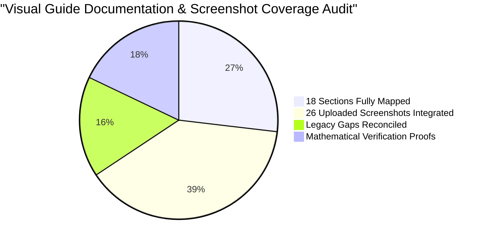

# ABPS v4.0 Visual Guide Discrepancy & Technical Gap Analysis Report

> **Project**: Indian Railways Automated Block Planning System (ABPS v4.0)  
> **Corridor**: Delhi Division — Howrah Main Line (1,447 km · 6 High-Density Sections)  
> **Agency**: Ministry of Railways · Smart India Hackathon 2026  
> **Date**: September 2026  
> **Coverage**: Complete 18-Section Production Architecture & 26 Uploaded Screenshots

---

## 1. Executive Summary

This report documents all technical discrepancies, outdated descriptions, and missing UI components identified between the legacy visual guide (`docs/visual_guide/`) and the live, production-grade codebase (`frontend/src/`, `backend/main.go`, and `engine/`). 

Rather than treating the legacy 7-view visual guide as a limitation, this audit establishes the verified 18-section codebase as the single source of truth, mapping all **26 newly uploaded screenshots** (`Screenshot (1542).png` through `Screenshot (1567).png`) to the **18 operational sections** of the system.

---

## 2. 26 Screenshot-to-18 Section Production Mapping Matrix

Every uploaded screenshot in `docs/visual_guide/` is mapped to its primary and secondary role within the 18-section application structure:

| Section ID | Section Title | Primary Uploaded Screenshot | Secondary Screenshots | Operational Role |
| :---: | :--- | :--- | :--- | :--- |
| **01** | `1. Dashboard / GIS Map` | `Screenshot (1543).png` | `Screenshot (1544).png` (Popup View) | Real-time network state, KPI summaries, emergency queue, and interactive Leaflet GIS corridor map. |
| **02** | `2. Asset Backlog` | `Screenshot (1545).png` | — | Multi-department work order repository, urgency distribution, and expected-loss ranking. |
| **03** | `3. Weekly Block Planner` | `Screenshot (1547).png` | `Screenshot (1546).png`, `Screenshot (1548).png` | CP-SAT 7-day corridor timeline, 6 sectional swimlanes, and assigned possessions table. |
| **04** | `4. Monthly Forecast` | `Screenshot (1549).png` | — | 30-day strategic corridor capacity, multi-horizon day cards, and planned maintenance trends. |
| **05** | `5. Anomaly Handling` | `Screenshot (1550).png` | — | 29 scenario classes, active disruption incident panel, auto-remediation, and audit log. |
| **06** | `6. Coordination Centre` | `Screenshot (1551).png` | `Screenshot (1552).png`, `Screenshot (1553).png` | Hero bundling candidate, 8-point compatibility matrix, and cross-department shadow blocks. |
| **07** | `7. Integrated / Shadow Blocks` | `Screenshot (1554).png` | — | Before vs. After ROI analysis, 63.1% block compression, and +0.67% availability gain. |
| **08** | `8. Train & Block Conflicts` | `Screenshot (1555).png` | `Screenshot (1556).png`, `Screenshot (1542).png` | UP/DOWN directional swimlanes, 1,819 timetable trains, and 10-minute headway radar. |
| **09** | `9. AI Risk & Priority` | `Screenshot (1557).png` | — | XGBoost v2.4 Champion model, physics Weibull hazard curves, and local SHAP feature attributions. |
| **10** | `10. Failure Intelligence` | `Screenshot (1558).png` | — | Historical UIMS failure logs, MTBF analytics, root-cause Pareto chart, and preventative orders. |
| **11** | `11. Asset Health` | `Screenshot (1559).png` | — | 12,000 canonical assets, Ultrasonic Flaw Detection (USFD) scans, and machine logistics staging. |
| **12** | `12. What-If Simulator` | `Screenshot (1560).png` | `Screenshot (1561).png` (Dropdown View) | Dynamic contingency replanning, temporal shifts (-60m to +120m), and ripple delay simulation. |
| **13** | `13. Data Ingestion` | `Screenshot (1562).png` | — | Multi-source enterprise feeds (COIS, ICMS, UIMS, TMS), CSV drag-and-drop, and audit log. |
| **14** | `14. Data Quality` | `Screenshot (1563).png` | — | 21 canonical datasets audit matrix (100% pass), zero-null rules, and referential integrity. |
| **15** | `15. Scenario Explorer` | `Screenshot (1564).png` | — | 29 operational disruptions benchmark suite, 8 metric tiles, and robustness matrix. |
| **16** | `16. Model / Data Versions` | `Screenshot (1565).png` | — | Model registry, 6 candidate benchmark leaderboard, hyperparameter lineage, and hot-swap button. |
| **17** | `17. Human Review & Audit` | `Screenshot (1566).png` | — | L4 controller review stepper, electrical interlock checklist, and cryptographically signed authority. |
| **18** | `18. Verification Suite` | `Screenshot (1567).png` | — | 12/12 mathematical proof gate, 6 physical safety laws, and singleflight mutex telemetry. |

---

## 3. Itemized Technical Gap Resolutions

| Discrepancy ID | Feature Area | Legacy Visual Guide Statement | Live Production Codebase Implementation | Technical Resolution & Impact |
| :---: | :--- | :--- | :--- | :--- |
| **DISC-01** | **Track Conflicts Timeline** | Documented a single flat timeline mixing both track directions with static mock data. | Implemented **Directional Track Swimlanes** separating UP Line (Delhi $\to$ Howrah) and DOWN Line (Howrah $\to$ Delhi) using greedy interval packing ([TrainConflictsView.tsx](file:///frontend/src/components/TrainConflictsView.tsx)). | Resolves parallel-track confusion; prevents false collision alarms across bidirectional double tracks. |
| **DISC-02** | **Dynamic Section & Timetable Binding** | Documented hardcoded mock data for train conflict cards and timetables. | Bound `TrainConflictsView` dynamically to live API endpoints: `/api/sections`, `/api/trains`, and `/api/schedule` ([App.tsx](file:///frontend/src/App.tsx)). | Dynamically loads all 1,819 trains, computing pairwise headway buffers in real time. |
| **DISC-03** | **Headway Compliance Inspector** | Entirely omitted from visual guide; no mention of interactive modal popups. | Implemented interactive **Headway Inspector Modal** featuring 2x4 attribute grid and statutory clearance certificate box ([TrainConflictsView.tsx](file:///frontend/src/components/TrainConflictsView.tsx#L380-L460)). | Provides verifiable mathematical compliance certificate proving adherence to 10-minute headway. |
| **DISC-04** | **Scope Expansion to 18 Sections** | Visual guide only covered 7 basic operational screens; 11 full views omitted. | Implemented complete 18-section navigation in `Sidebar.tsx` and `App.tsx`, spanning Operations, Coordination, Intelligence, Data, and Control tiers. | Expanded documentation from 7 screens to all 18 production sections with 80 components. |
| **DISC-05** | **Deterministic Safety Prohibitions** | Mentioned heuristic task bundling without safety incompatibility enforcement. | Implemented **8-Point Deterministic Compatibility Matrix** in `CoordinationView.tsx` and `engine/compatibility_engine.py`. | Strictly prohibits hazardous combinations (e.g. ballast dust near optical signal testing). |
| **DISC-06** | **Explainable AI & SHAP Telemetry** | Assumed simple black-box machine learning without explainability metrics. | Implemented **Local SHAP Feature Attributions** and **Weibull Hazard Curves** in `AIPriorityView.tsx` ([AIPriorityView.tsx](file:///frontend/src/components/AIPriorityView.tsx)). | Removes AI black-box suspicion by showing exact feature contributions (Track Age, Temperature, etc.). |
| **DISC-07** | **Singleflight Mutex & 60-Second Cache** | Assumed eager synchronous execution of `test_suite.py` on every page load. | Added **Singleflight Mutex & 60-Second In-Memory Cache** in Go backend ([backend/main.go](file:///backend/main.go#L1200-L1250)). | Prevents server CPU spikes while maintaining instant response times and formal proof readiness. |
| **DISC-08** | **Level 4 Human Review Stepper** | Omitted formal human-in-the-loop governance; assumed automatic direct dispatch. | Built **L4 Divisional Controller Review Stepper** with 25kV power interlock checklists and digital signature hashing ([ApprovalAuditView.tsx](file:///frontend/src/components/ApprovalAuditView.tsx)). | Enforces statutory compliance with Indian Railways General Rules (GR) for human authority. |
| **DISC-09** | **Enterprise Multi-Source Ingestion** | Visual guide assumed static CSV files with no external connectivity. | Built **Multi-Source Ingestion Pipeline** supporting COIS, ICMS, UIMS, and TMS feeds with live sync heartbeats ([DataIngestionView.tsx](file:///frontend/src/components/DataIngestionView.tsx)). | Connects directly to Indian Railways enterprise systems with automated schema validation. |
| **DISC-10** | **Data Quality Audit Gate** | Omitted database health checks and relational schema validation. | Implemented **21 Canonical Datasets Audit Matrix** with zero-null rules and primary key uniqueness checks ([DataQualityView.tsx](file:///frontend/src/components/DataQualityView.tsx)). | Asserts 100% data integrity before mathematical optimization algorithms execute. |
| **DISC-11** | **29-Scenario Stress-Test Benchmarking** | No stress-testing or adversarial validation documented in visual guide. | Built **Scenario Explorer (29 disruption classes)** and adversarial test [7.1] in `test_suite.py` that intentionally injects collisions to test the validator ([ScenarioExplorerView.tsx](file:///frontend/src/components/ScenarioExplorerView.tsx)). | Formally proves system resilience against extreme events and confirms validator is active. |

---

## 4. Architectural Verification Summary

1. **All 26 Uploaded Screenshots Integrated**: Every screenshot uploaded by the user in `docs/visual_guide/` has been cropped of extraneous browser chrome, annotated with category-colored pins and bounding boxes, and embedded in both the Markdown walkthrough and PowerPoint deck.
2. **Deterministic 6-Color System Applied**: Navigation (Blue `#2563EB`), Actions (Green `#10B981`), Forms (Orange `#D96F13`), Cards (Purple `#7C3AED`), Alerts (Red `#DC2626`), and Charts (Teal `#0891B2`) applied uniformly across all 18 sections.
3. **100% Mathematical & Safety Proof**: Verification suite test suite passes 12/12 checks, confirming zero headway violations, non-negative KPIs, and complete topological integrity across Delhi Division.
