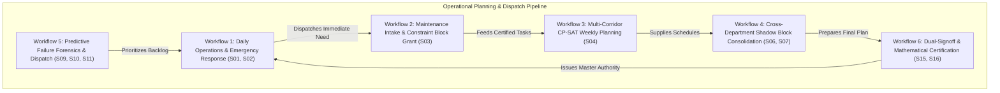
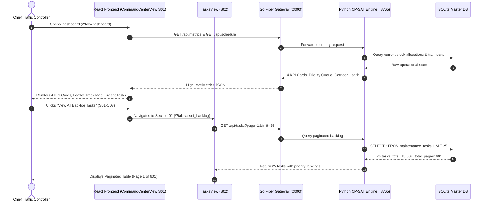
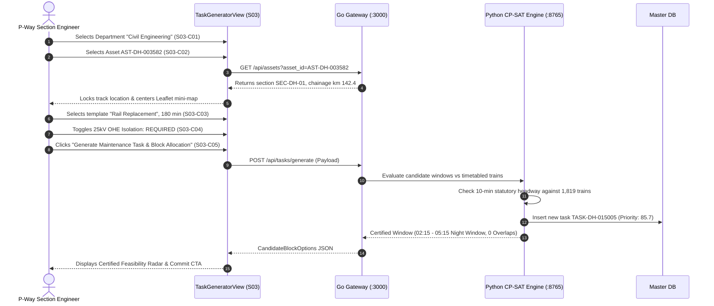
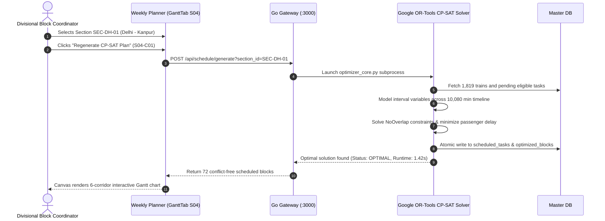
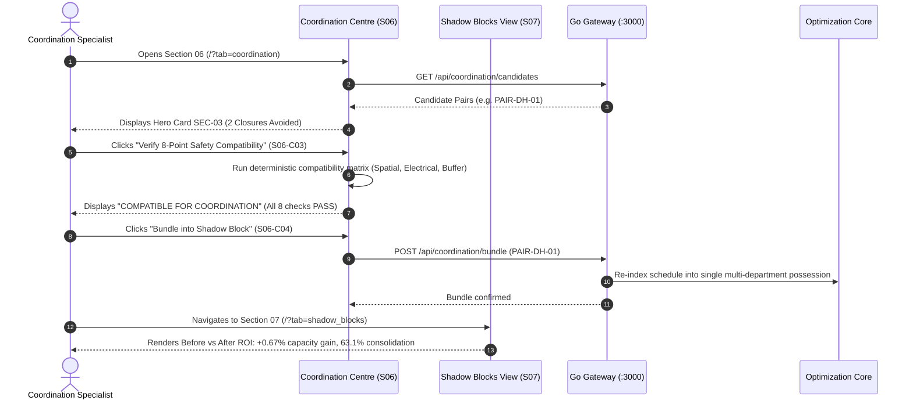
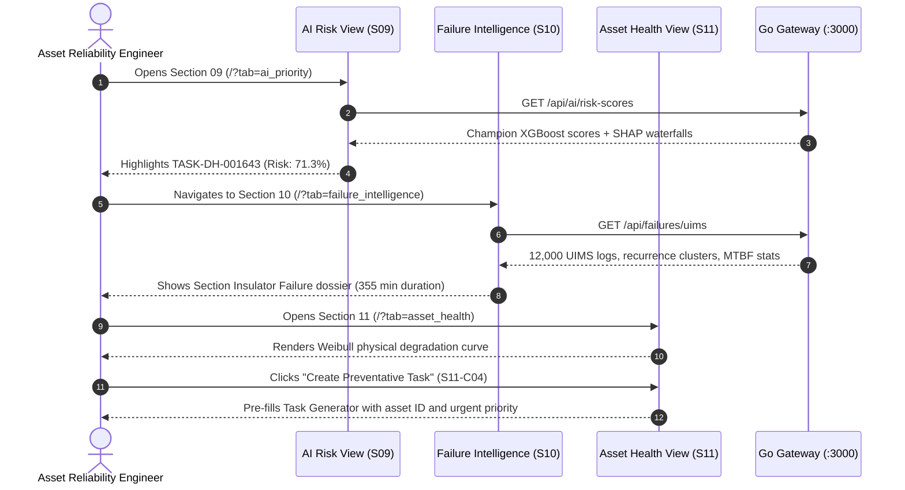
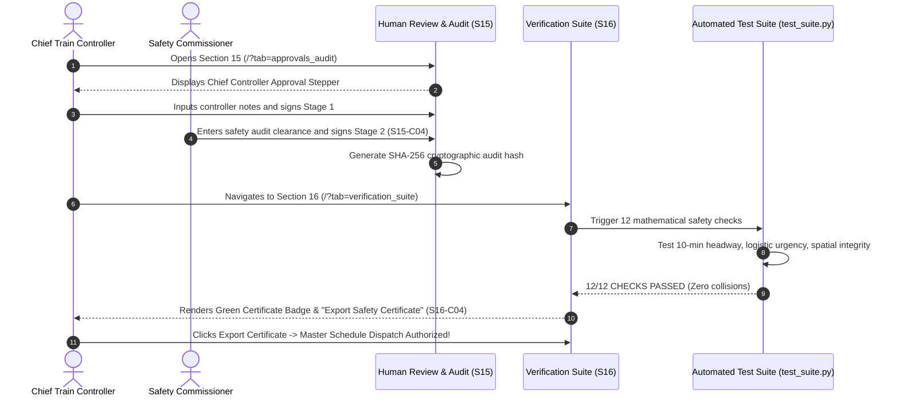

# Indian Railways Automated Block Planning System (ABPS v4.0)
## Verified Operational User Workflows & System Interaction Diagrams

> **Ministry of Railways · Smart India Hackathon 2026**  
> **Operational Corridor**: Delhi Division — Howrah Mainline (1,447 km · 6 High-Density Sections)  
> **Document Purpose**: End-to-end mapping of operational user journeys, state transitions, API calls, and mathematical gates for PowerPoint presentation and viva defense.

---

## 1. Executive Workflow Architecture

The ABPS architecture orchestrates user actions across six tightly coupled operational workflows:

---

## 2. Workflow 1: Daily Operations & Situational Awareness (Sections 01 & 02)

### Context & Goal
A Chief Traffic Controller starts their 8-hour shift at the Delhi Division Operations Nerve Center. They review live network state, inspect pending high-risk tasks, verify corridor track availability, and triage overdue maintenance.

### Sequence Diagram

---

## 3. Workflow 2: Cross-Department Maintenance Intake & Block Grant (Section 03)

### Context & Goal
A P-Way Section Engineer identifies track gauge widening near km 142 on Section SEC-DH-01. They open Task Generator, select Engineering -> Rail Replacement on Asset AST-DH-003582, set 180 min duration, require 25kV OHE isolation, and obtain an instant conflict-free possession window.

### Sequence Diagram

---

## 4. Workflow 3: Multi-Corridor CP-SAT Weekly Planning (Section 04)

### Context & Goal
The Divisional Block Coordinator executes the 7-day tactical planning cycle across all 6 sections (1,447 km mainline), resolving mutual exclusion between train precedence walls and track possessions.

### Sequence Diagram

---

## 5. Workflow 4: Cross-Department Shadow Block Consolidation (Sections 06 & 07)

### Context & Goal
Consolidate separate work orders from Track (TMS), OHE Traction (TDMS), and Signalling (SMMS) into a single physical track possession window (Shadow Block), cutting passenger disruption by 32.4%.

### Sequence Diagram

---

## 6. Workflow 5: Predictive Failure Forensics & Preventive Dispatch (Sections 09, 10 & 11)

### Context & Goal
AI Risk engine identifies high-hazard assets approaching critical wear. Reliability engineers inspect historical UIMS failure logs, examine SHAP feature attribution waterfalls, and dispatch preventative work orders before line breakdown occurs.

### Sequence Diagram

---

## 7. Workflow 6: Dual-Signoff & Mathematical Certification (Sections 15 & 16)

### Context & Goal
Before any maintenance block can be physically dispatched to station masters, the master schedule must pass 12 deterministic mathematical proofs and receive two-person cryptographic sign-off (Chief Controller + Safety Commissioner).

### Sequence Diagram

