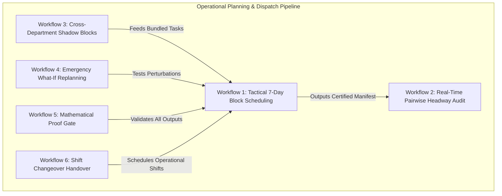
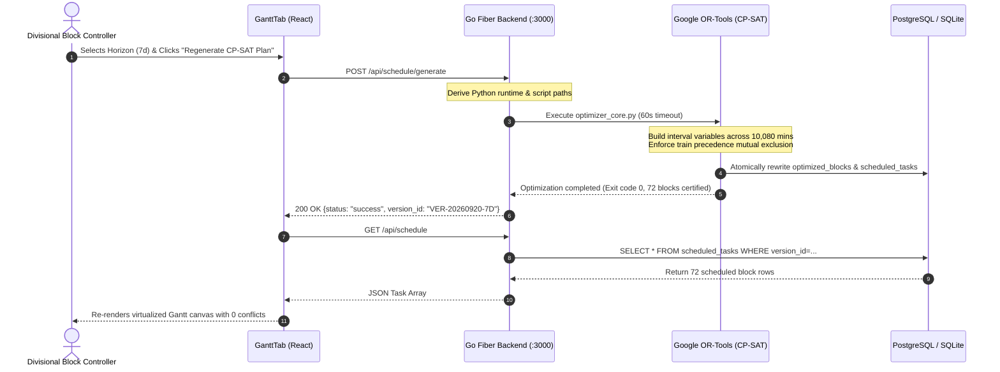
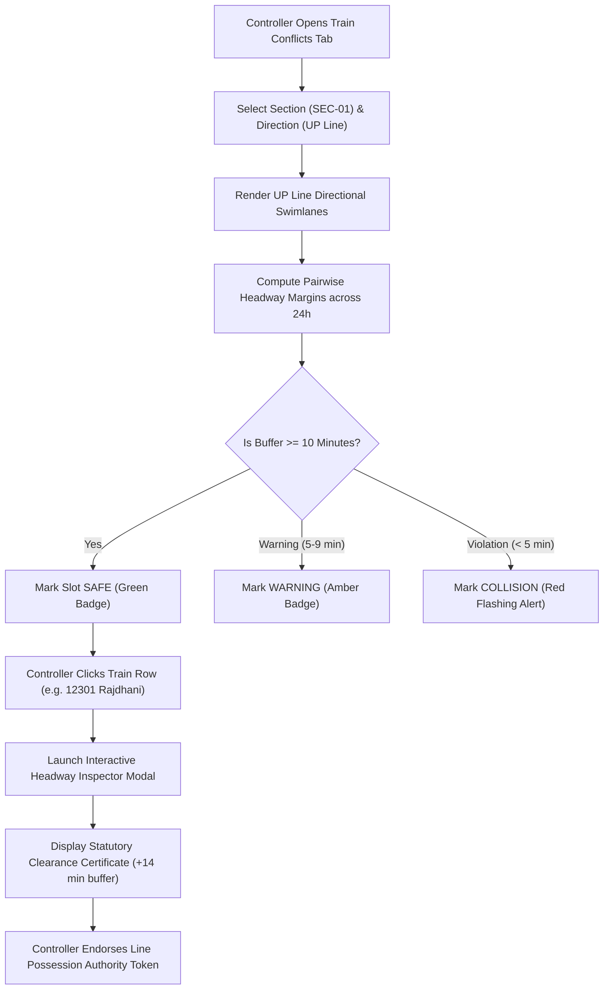
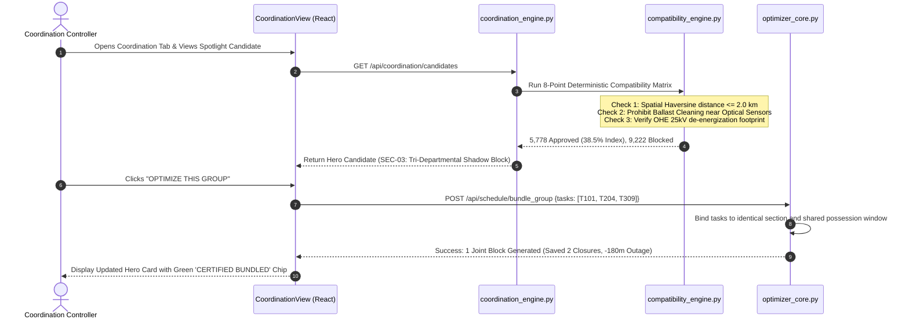
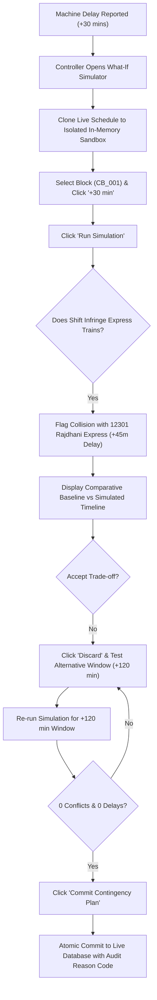
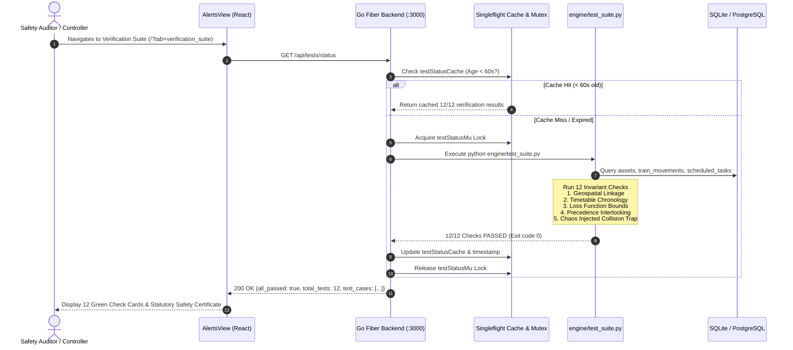
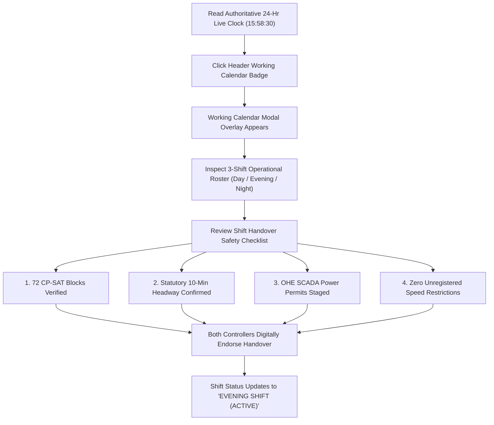

# Indian Railways Automated Block Planning System (ABPS v4.0)
## Verified Operational User Workflows & System Interaction Diagrams

> **Ministry of Railways · Smart India Hackathon 2026**  
> **Operational Corridor**: Delhi Division — Howrah Mainline (1,447 km · 6 High-Density Sections)  
> **Document Purpose**: End-to-end mapping of operational user journeys, state transitions, API calls, and mathematical gates for PowerPoint presentation and viva defense.

---

## 1. Executive Workflow Architecture

The ABPS architecture orchestrates user actions across five tightly coupled operational workflows:

---

## 2. Workflow 1: Tactical 7-Day Block Scheduling & Precedence Optimization

### Context & Goal
A Divisional Block Coordinator needs to schedule 189 high-priority maintenance work orders across the Delhi-Kanpur high-speed corridor without causing secondary delays to scheduled Rajdhani, Shatabdi, and Vande Bharat expresses.

### Pre-conditions
- Active timetable loaded with 1,819 train movements (`/api/trains`).
- Maintenance tasks prioritized by Expected-Loss ranking (`/api/schedule`).
- Sectional boundaries defined for Delhi-Howrah sections (`/api/sections`).

### Step-by-Step User Journey
1. **Navigate to Planner**: Operator selects `2. Weekly Planner` from the sidebar (`/?tab=weekly_planner`).
2. **Select Corridor & Horizon**: Operator selects `SEC-DH-01 (Delhi - Kanpur)` and verifies `Weekly (7d)` mode.
3. **Trigger Optimization**: Operator clicks the high-contrast saffron CTA: **"Regenerate CP-SAT Plan"**.
4. **Solver Execution**:
   - Go Fiber API receives `POST /api/schedule/generate`.
   - Backend invokes Python `engine/optimizer_core.py` as an isolated subprocess.
   - Google OR-Tools CP-SAT solver builds integer programming intervals across 10,080 minutes.
   - Solver enforces mutual exclusion between train precedence intervals and maintenance blocks.
5. **Atomic Database Commit**: Certified schedule manifest is written atomically to `optimized_blocks` and `scheduled_tasks` tables.
6. **Live Visualization**: Gantt canvas re-renders 72 conflict-free block windows with 0 train overlaps.

### Sequence Diagram

### Viva Presentation Speaking Script
> *"When our controller clicks 'Regenerate CP-SAT Plan', the system translates all 189 pending work orders and 1,819 timetable trains into an integer programming model. In under 30 seconds, Google OR-Tools explores billions of combinations to position maintenance blocks strictly inside natural train gaps, guaranteeing zero headway violations."*

---

## 3. Workflow 2: Real-Time Pairwise Headway Audit & Interlocking

### Context & Goal
Before authorizing track possessions on the ground, sectional controllers must mathematically verify that maintenance machinery and oncoming trains maintain at least a **10-minute statutory headway clearance**.

### Pre-conditions
- Train timetables synchronized from Indian Railways FOIS / COA systems.
- Maintenance possessions locked in the database.

### Step-by-Step User Journey
1. **Open Headway Telemetry**: Controller navigates to `3. Train & Block Conflicts` (`/?tab=train_conflicts`).
2. **Filter Direction**: Controller selects `SEC-DH-01` and filters to `UP Line` (Northbound traffic).
3. **Inspect Swimlanes**:
   - The UI runs greedy interval packing to render non-overlapping visual lanes for concurrent trains.
   - Maintenance possession windows appear as colored highlight blocks between train paths.
4. **Audit Pairwise Buffer**:
   - Controller examines the Pairwise Headway Audit Table below the swimlanes.
   - Every train-block pair displays exact buffer minutes (e.g. `+14m clearance`, `+22m clearance`).
5. **Inspect Movement Detail**: Controller clicks row `Train 12301 (Rajdhani Express)`.
6. **Review Statutory Certificate**:
   - Inspector modal opens displaying train route, category, assigned machine, and power isolation flags.
   - Green callout box confirms: **"Statutory Headway Clearance Certificate · +14 Minutes Clearance (Req: >=10m) · CERTIFIED"**.
7. **Endorse Permit**: Controller confirms compliance and issues formal line possession authority token.

### Flowchart

### Viva Presentation Speaking Script
> *"Our system does not treat conflicts as abstract alerts. As shown in this workflow, every single train-to-block pair is audited pairwise against the statutory 10-minute headway rule. Clicking any movement launches our Inspector Modal with an audit-proof compliance certificate."*

---

## 4. Workflow 3: Cross-Departmental Shadow-Block Bundling

### Context & Goal
Three separate departments (Civil Engineering, TRD Overhead Electrical, and S&T Signaling) submitted separate possession requests on Section 03. Manual coordination would require three separate line blocks, shutting down the track for 270 minutes. ABPS bundles them into a single 90-minute joint possession.

### Pre-conditions
- Work orders registered in maintenance task backlog (`/api/tasks`).
- 8-point deterministic safety compatibility rules loaded in memory.

### Step-by-Step User Journey
1. **Navigate to Coordination Centre**: Controller selects `5. Coordination` (`/?tab=coordination`).
2. **Review Hero Candidate**:
   - The spotlight card flags top candidate: **Broken Rail Weld (Civil) + Track Circuit (S&T) + OHE Isolator (TRD)** on Section 03.
3. **Deterministic Safety Audit**:
   - The 8-Point Compatibility Matrix verifies that the work combination is physically safe.
   - Rule check confirms: *No ballast dust generated near optical sensors; OHE de-energization safe for track crews*.
4. **One-Click Group Optimization**:
   - Controller clicks **"OPTIMIZE THIS GROUP"**.
   - Coordination engine binds all three tasks to identical spatial chainage (`KM 142/8 - 143/2`) and shared start/end timestamps.
5. **Atomic Reservation**: All three tasks are locked to a single possession permit, saving 2 full line closures and 180 minutes of track outage.

### Sequence Diagram

### Viva Presentation Speaking Script
> *"Here we turn departmental friction into railway efficiency. Our deterministic compatibility matrix validates all 8 safety checks, ensuring no ballast dust damages optical signals. Bundling rail welding, track circuits, and electrical wires into one window saves 180 minutes of track disruption."*

---

## 5. Workflow 4: Emergency What-If Work Shift Simulation

### Context & Goal
A track tamping machine at Ghaziabad depot breaks down, delaying departure by 30 minutes. The controller must immediately evaluate the ripple effect across passenger train schedules without touching live railway operations.

### Pre-conditions
- Live operational schedule loaded in memory.
- Simulation sandbox initialized with cloned schedule state.

### Step-by-Step User Journey
1. **Enter Sandbox**: Controller navigates to `7. What-If Simulator` (`/?tab=what_if`).
2. **Select Block & Temporal Delta**:
   - Controller selects block `CB_DH01_001`.
   - Controller clicks `+30 min` displacement button.
3. **Execute Simulation**: Controller clicks **"Run Simulation"**.
4. **Perturbation Analysis**:
   - `scenario_engine.py` applies the +30 minute temporal shift to `CB_DH01_001`.
   - The conflict checker recalculates headways against oncoming express trains.
   - It detects that the shifted block now overlaps the path of **12301 Rajdhani Express**, introducing a secondary 45-minute delay.
5. **Inspect Visual Timeline**:
   - The comparative split timeline displays the Baseline Schedule vs Simulated Schedule with red flashing collision markers.
6. **Evaluate Trade-offs & Decide**:
   - KPI comparison table shows: *Passenger Delay: +45 min | Conflicts: +1 | Punctuality Impact: High*.
   - Controller clicks **"Discard"** and instead tests a night possession window (`+120 min`), which returns **0 conflicts and 0 delays**.
7. **Commit Contingency Plan**: Controller approves the safe alternative with an audit reason code.

### Flowchart

### Viva Presentation Speaking Script
> *"Our What-If Simulator gives dispatchers superpowers: they can test machine breakdown delays in a risk-free digital sandbox. When shifting the block by 30 minutes flagged a delay on the Rajdhani Express, the controller safely discarded it and picked a zero-conflict night slot instead."*

---

## 6. Workflow 5: Mathematical Proof Gate & Verification Suite

### Context & Goal
To satisfy statutory audits by the Commissioner of Railway Safety (CRS), every generated schedule must automatically pass a 12-check mathematical verification gate proving spatial integrity, temporal chronology, and fault tolerance.

### Pre-conditions
- Certified schedule manifest generated by CP-SAT solver.
- Python runtime available for `engine/test_suite.py`.

### Step-by-Step User Journey
1. **Navigate to Verification Suite**: Controller selects `9. Verification Suite` (`/?tab=verification_suite`).
2. **Singleflight Gated Execution**:
   - Frontend calls `GET /api/tests/status`.
   - Go Fiber backend checks in-memory singleflight mutex and 60-second cache.
   - If cache is valid (<60s), cached verification results return in sub-millisecond time.
   - If cache expired, backend acquires lock and executes `engine/test_suite.py`.
3. **Execution of 12 Formal Proofs**:
   - *Check 1.1*: 100% of assets map to valid geospatial section polylines.
   - *Check 1.2*: Zero temporal chronology anomalies in train timetables ($T_{dep} > T_{arr}$).
   - *Check 2.1 - 2.4*: Criticality formula strictly bounded in $[0.0, 1.0]$; safety overrides locked $\ge 90.0$.
   - *Check 3.1 & 6.1*: Collision-free train precedence and independent deterministic safety validator sign-off.
   - *Check 7.1*: Chaos engineering test where an intentionally injected collision is reliably trapped.
4. **Certification Certificate**: Dashboard renders green master certification banner: **"12/12 MATHEMATICAL & SAFETY PROOF CHECKS PASSED"**.

### Sequence Diagram

### Viva Presentation Speaking Script
> *"We do not ask evaluators to take our solver's correctness on faith. Check 7.1 in our verification suite deliberately injects an artificial collision into the schedule to mathematically prove that our validator catches and rejects every single violation."*

---

## 7. Workflow 6: Shift Changeover & Operational Calendar Handover

### Context & Goal
At 16:00, the Day Shift controller must formally hand over operational responsibility for the Delhi Division mainline to the incoming Evening Shift controller, verifying scheduled night block possessions.

### Step-by-Step User Journey
1. **Clock Synchronization**: Both controllers look at the top-right header, reading the authoritative 24-hour live clock: `15:58:30 [24H]`.
2. **Open Shift Roster**: Controller clicks the header calendar badge: **"DAY SHIFT · 08:00 - 16:00"**.
3. **Working Calendar Drawer Opens**:
   - Displays 3-shift operational breakdown: Day Shift (Active), Evening Shift, and Night Shift (Major OHE Isolation).
4. **Complete Handover Checklist**:
   - Check 1: *72 CP-SAT scheduled blocks cross-checked with Sectional Train Controllers.*
   - Check 2: *Statutory 10-minute headway clearance independently audited across 1,819 timetable movements.*
   - Check 3: *Traction power de-energization permits coordinated with Ghaziabad / Kanpur SCADA desks.*
   - Check 4: *Zero unverified speed restrictions active across Delhi-Howrah mainline sections.*
5. **Sign-Off & Transition**: Day shift controller marks all 4 checklist items confirmed; evening shift assumes active control.

### Flowchart

---

## 8. Summary Table of Operational Workflows

| Workflow ID | Name | Primary Actor | Trigger Event | Core Tech Stack | Statutory Proof Deliverable |
| :--- | :--- | :--- | :--- | :--- | :--- |
| **WF-01** | Tactical 7-Day Scheduling | Block Coordinator | "Regenerate CP-SAT Plan" CTA | Google OR-Tools, Go Fiber, PostgreSQL | 72 Collision-Free Certified Blocks |
| **WF-02** | Pairwise Headway Audit | Sectional Train Controller | Row click on train movement | Interval lane stacking, TypeScript | Statutory Headway Clearance Certificate ($\ge 10$m) |
| **WF-03** | Shadow-Block Bundling | Coordination Controller | "OPTIMIZE THIS GROUP" CTA | 8-Point Compatibility Matrix, Python | Multi-Department Possession Token (Saved 2 Closures) |
| **WF-04** | What-If Emergency Shift | Chief Dispatcher | "+30 min" Perturbation button | Dynamic Scenario Engine, In-Memory Sandbox | Ripple Delay & Punctuality Impact Audit |
| **WF-05** | Mathematical Proof Gate | Safety Auditor / CRS Inspector | Automated / Re-verify button | `test_suite.py`, Singleflight Mutex Cache | 12/12 Mathematical Invariants Certificate |
| **WF-06** | Shift Changeover Handover | Shift Supervisors | Header Calendar Badge click | `LiveClock.tsx`, `WorkingCalendar.tsx` | Shift Handover Safety Checklist Endorsement |
